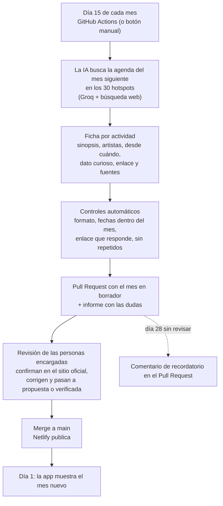

# Flujo mensual de actividades culturales

Cómo se cargan cada mes las actividades que se ven en "Últimas fechas disponibles" y en su ficha (qué vas a ver, quiénes participan, desde cuándo, dato curioso y enlace). **La IA propone, una persona decide**: nada se publica sin revisión.

## Diagrama

## Qué pasa en cada paso

| Paso | Qué hace | Dónde está |
|---|---|---|
| 1. Disparo | El día 15 a las 09:00 (hora de Buenos Aires), unas dos semanas antes de que termine el mes. También se puede lanzar a mano desde GitHub → Actions → "Actividades del mes siguiente" → *Run workflow*, y elegir el mes. | [.github/workflows/actividades-mensual.yml](../.github/workflows/actividades-mensual.yml) |
| 2. Búsqueda | Por cada hotspot, la IA (Groq, modelo `openai/gpt-oss-120b` con búsqueda web) lista hasta 4 actividades del mes con todos los campos. Prioriza el sitio oficial. | [codigo/recolectar_actividades.ps1](../codigo/recolectar_actividades.ps1) (`-Modo actividades`) |
| 3. Controles | Se descartan las actividades sin enlace de fuente, las que no caen en el mes y las que ya estaban cargadas. Cada enlace se prueba; si no responde, queda anotado. | mismo script |
| 4. Borrador | Se escribe `app/data/actividades_AAAA_MM.js` y `datasets_procesados/actividades_AAAA_MM.json`, con `estado: "borrador"`. La app **no muestra** los borradores. | `app/data/`, `datasets_procesados/` |
| 5. Pull Request | Se abre un PR con un informe: tabla de lo encontrado, instrucciones y las dudas para mirar primero. | `datasets_procesados/informe_actividades_AAAA_MM.md` |
| 6. Revisión | Una persona abre el enlace de cada actividad, confirma fechas, horario, precio y textos, corrige y cambia el estado (ver abajo). | el PR |
| 7. Publicación | Al hacer *merge* a `main`, Netlify publica. `app/data/meses.js` le indica a la app qué archivos de mes cargar. | `app/data/meses.js` |
| 8. Recordatorio | El día 28, si el PR sigue abierto, el flujo deja un comentario. | mismo workflow |

## Estados de una actividad

| Estado | Qué significa | ¿Se ve en la app? |
|---|---|---|
| `borrador` | Lo generó la IA, nadie lo revisó. | No |
| `propuesta` | Revisada por encima o con datos que faltan confirmar. | Sí, con el aviso "a confirmar" |
| `verificada` | Una persona confirmó todo en el sitio oficial (poner también `ficha_verificada: true`). | Sí, sin aviso |

## Cómo revisar (checklist para quien recibe el Pull Request)
1. Abrí `datasets_procesados/actividades_AAAA_MM.json`.
2. Para cada actividad, entrá a `url_oficial`: confirmá **fechas, horario, precio**.
3. Leé `sinopsis`, `artistas`, `trayectoria` y `dato_curioso`: tienen que decir lo mismo que la fuente. Si algo no se puede comprobar, borralo (mejor vacío que inventado).
4. Cambiá `estado` a `propuesta` o `verificada`. Borrá las actividades que no correspondan.
5. Hacé *merge*. Si querés ver cómo queda antes: Netlify genera una vista previa del PR.

## Campos de cada actividad
`id`, `nombre`, `tipo` (muestra, ciclo, festival, feria, temporada, obra, concierto, visita, otro), `lugar_id`, `lugar`, `lat`, `lon`, `barrio`, `desde`, `hasta`, `dias`, `abre`, `cierra`, `precio`, **`sinopsis`**, **`artistas`**, **`trayectoria`**, **`dato_curioso`**, **`url_oficial`**, `url_ok`, `fuentes`, `estado`, `ficha_generada`, `ficha_verificada`, `obs`.

## Fichas de los 30 hotspots (datos que no cambian cada mes)
Se generan una sola vez (y se pueden rehacer cuando haga falta) con `./codigo/recolectar_actividades.ps1 -Modo fichas`. Usa Wikipedia y Wikidata como fuente (rápido y citable) y, si un lugar no tiene página, la búsqueda web. Quedan en `app/data/fichas.js` con `verificado: false`; cuando una persona revisa una ficha pone `verificado: true` y el script ya no la pisa.

## Puesta en marcha (una sola vez)
1. En GitHub → *Settings* → *Secrets and variables* → *Actions* → *New repository secret*: nombre `GROQ_API_KEY`, valor tu clave de Groq.
2. *Settings* → *Actions* → *General* → *Workflow permissions*: elegir **Read and write permissions** y tildar **Allow GitHub Actions to create and approve pull requests**.
3. Para probar: *Actions* → "Actividades del mes siguiente" → *Run workflow*.

## Límites a tener en cuenta
- **Cupo de Groq.** El plan gratuito permite unos 8.000 tokens por minuto y cada búsqueda web usa muchos (en las pruebas, 100.000 a 160.000 por llamada). El script espera lo que Groq pide, así que una corrida completa de 30 lugares puede tardar varias horas (el flujo admite hasta ~6 h). Si se agota el cupo del día, guarda lo hecho y lo avisa en el informe. Con un plan de pago el mismo flujo termina en minutos y cuesta del orden de 1 USD por mes.
- **La IA puede equivocarse.** Por eso todo entra como borrador, con fuente y enlace obligatorios, y la revisión humana es parte del flujo, no un extra.
- **Cobertura.** Busca en los 30 hotspots. Para sumar más lugares, se cambia la función `Hotspots` del script.
